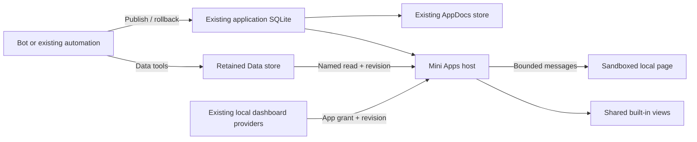

# Local Mini Apps

Mini Apps are persistent applications in **Computer → Mini Apps**. An app has a
stable identity, immutable template versions and explicit read permissions. Most
apps use editable HTML and declared Data queries; Agent Team and Work Tracker use
registered built-in views. Each app belongs to the local workspace owner,
independently of the chat or bot that created it. Opening, filtering and
refreshing an app does not start an AI turn.

Bookkeeping, Daily X AI digest and GitHub activity use the same registry, retained
Data and frame host. An inventory fixture also exercises these APIs independently
of the built-in templates. The two report apps keep current and historical
editions published by an existing bot or Automation.

## Find and open apps

Opening the desktop library adds five included apps to the existing registry:
Bookkeeping, Daily X AI digest, GitHub activity, Agent Team and Work Tracker.
There is no installation wizard. The local-owner `POST /api/mini-apps/defaults`
operation receives the bundled bookkeeping HTML, creates missing entries and
returns the real persisted inventory. It does not create or start an Automation.

Apps appear in one row with a large icon and a small label below it. **All apps**
opens an icon grid anchored to its button. Remove hides an app while preserving
its history and Data. Removed apps stay removed across restart and updates;
**Add** restores the same identity. Unknown custom apps have a default icon.

Bookkeeping automatically finds an existing physical ledger with the seven known
columns, preferring a unique `main.ledger_master`. It retains the Bot's existing
DuckDB store and keeps the Bot writing through its alias to that same store.
Only the source Bot receives a publisher grant. Ambiguous sources are left
unchanged and reported; unrelated empty Bot databases are not created. Reports
connect to a uniquely identified existing local producer Automation. If no source
exists yet, an included app displays a waiting page. Opening the library again
connects that untouched waiting page when a source becomes available.

Bundled display identity is recorded as `shippedTemplateKind`; it grants no reads.
Default initialization preserves customized or already bound apps. A custom app
using a bundled slug is kept, and the new included app receives an available
suffixed slug. Older unmarked records are not silently adopted. Native dashboard
identity and current read grants remain separate; initialization does not restore
a revoked grant.

## Agent Team and Work Tracker

Open either app directly from **Computer → Mini Apps**. The original Computer
tabs remain available. Both surfaces use the same providers and shared views;
the included apps do not start a collector, copy snapshots into another store
or change a schedule. Work Tracker keeps the internal `usage` identity and routes.

Agent Team reads local Herdr member status, models and bounded task hints. An
expanded activity disclosure reads recent redacted user and assistant messages;
it starts folded, and no office is selected initially. The app cannot control
agents. Team observations refresh every two seconds while visible, and activity
reads stop when the disclosure closes or the app is hidden.

Work Tracker reads the existing five-minute aggregate, including its coverage and
capture time. Manual refresh rereads the current provider snapshot immediately
without changing the automatic cadence or selected office. Its 1/7/30-day windows include the current partial China-calendar
day. Commit totals use the existing local non-merge, commit-hash deduplication,
including local and unmerged branches; they are not GitHub contribution-calendar
totals. PR counts, total tokens and cache-read tokens retain the existing
[metric definitions](verification/local-dashboard.md#usage-definitions).
Unavailable data remains unavailable; partial counts, stale snapshots and
verified zero values retain their separate meanings.

These two views are built into the host. Their registered metadata identifies
`renderer: "native"`, `htmlRole: "fallback-only"` and the editable title and
description fields. Publishing HTML changes only the fallback document, never
the live panel layout or its observations. These views do not offer a chat
editor. Other Mini Apps retain normal editable HTML behavior.

Removing archives the app and clears its dashboard read grant while keeping
its identity and history. Adding it again uses that same app ID and requires an
explicit owner grant at the current revision. Rolling back a template or
restoring a workspace backup cannot restore a revoked dashboard grant.
The library offers an explicit access-recovery action for a registered built-in
app after restore or revocation. Its persistent `dashboardIdentity` identifies
that entry but grants no reads; a custom app with the same slug is never silently
replaced or granted access.

## Reports

Daily X AI digest and GitHub activity are included automatically. The server
resolves an eligible existing local producer, prepares its retained report table
and grants that Bot as editor. An empty table shows that no edition has been
published; it does not display invented sample content. Existing schedules and
other outputs remain in place. See the [report publication contract](mini-app-reports.md).

## Bookkeeping

Open Bookkeeping to read the existing ledger directly. The portal has overview,
calendar and record views, week/month/year periods, corresponding elapsed-period
comparisons, monthly trends, category shares and largest outflows. Filters apply
to the same recorded dates without shifting them through a browser time zone.
There is no source picker, column-mapping wizard or currency selector in normal use.

The main view presents explicitly recognized CNY records. Foreign, blank and
unknown currency values are not relabeled or combined with CNY. Missing dates
and invalid or unrepresentable amounts remain visible as coverage limitations.

Negative amounts are outflow and positive amounts are inflow. They are not
automatically classified as expenses, income, refunds or transfers. Currency
groups remain separate, including null and blank currencies. Duplicate source
rows remain duplicate rows. Money stays decimal text through queries and rendering;
the example accepts two decimal places without silently rounding finer values.

The example only reads existing records. It does not create schedules, import
accounts, change the ledger or provide an entry form.

## Build and update other apps

The local `agents` tool catalog exposes:

| Tool | Purpose |
| --- | --- |
| `mini_app_info` | Discover apps this bot may edit and metadata for installed dashboards; read a granted document, bindings and history; obtain the complete author guide with `guide: true`. |
| `mini_app_connect` | Retain this bot's Data and return its stable dataset ID and physical table schemas. |
| `mini_app_publish` | Create an app or publish a new immutable template and binding version. |
| `mini_app_rollback` | Activate an earlier template while retaining current business data. |
| `mini_app_archive` | Remove an app from active navigation while keeping its history and Data. |
| `mini_app_report` | Prepare a built-in report template or atomically publish an edition to the calling bot's retained Data. |

Before creating a recurring report, the bot discovers the existing app. General
Data-only changes use the existing Data tools; the two built-in report kinds use
`mini_app_report` to preserve atomic edition writes and retry receipts. Layout,
behavior or binding changes publish a new template. The author guide is returned
by `mini_app_info`; the built-in `data-dashboards` skill follows this path for
reusable local reports.

Dashboard discovery exposes app identity, declared resources and editing limits,
not owner snapshots. An active built-in app remains discoverable when its read
grant needs owner repair. Bots cannot grant `dashboardKind` or read dashboard
resources. An existing publisher grant still permits only the supported
publication behavior; it does not make the built-in panel an HTML editor.

Publication uses `requestKey` and `expectedRevision`. A successful retry returns
the original receipt; reusing the key with different content or publishing over
a newer revision fails. Publisher grants are checked again before commit and
before replaying a receipt. Only the owner can change those grants. A publisher
can discover an archived app, but only the owner can reactivate it. A grant to edit
an app permits reuse of its current complete bindings; it does not grant access
to other tables, fields or queries in the same dataset, other apps, or revoked
historical bindings. Bots may declare new bindings for their own Data.

Inside an app, `window.mausApp.query(queryId, parameters, options)` reads one
declared, bounded query. `window.mausApp.onDataChanged(listener)` refreshes an
already mounted view. A query returns column definitions, rows, a Data revision
and an optional opaque cursor. Paged or parallel reads pin that revision so a
report does not mix different committed datasets.

An existing automation can update its bot's Data or use its current publisher
grant to publish a template. It uses the same turn capability and tool policy as
interactive work. This feature adds no scheduler or implicit routine permission.

## Storage and lifecycle

- The existing application SQLite owns app metadata, version pointers, publisher
  grants, idempotency receipts and stable dataset/store identities. There is no
  second SQLite owner or per-app service.
- The existing AppDocs store retains every referenced HTML version. Writes are
  durable before the registry head changes; failed publication preserves the
  previous head. Garbage collection retains historical references and stops
  before deleting anything if a retained document is unreadable.
- First connection promotes the whole DuckDB store into `stores/<storeId>`.
  Admission drains active operations, checkpoints the source, verifies a durable
  copy and journals the catalog switch. Recovery resolves the journal before
  admitting readers or writers. The original bot becomes an alias to that store.
- Supported business writes commit a persisted Data revision with the mutation.
  Result-cache writes do not advance it. The visible app checks revisions every
  15 seconds and offers manual refresh; a Data change keeps the template mounted.
- App revision and template version are distinct from Data revision. Rolling back
  a template advances the app revision and never rewinds the business database.
- Deleting a producer detaches its alias while the retained Data and app survive.
  The owner can preview retained sources and install another app from them.

Workspace backups hold the existing maintenance gate and Data admission barrier
through capture. They include closed retained stores, their identity/revision/hash
manifest, app metadata and referenced documents. Restore checks identities,
checksums, template references and the native DuckDB revision before replacing
anything. Untracked stores, unfinished promotion journals and missing references
fail the operation. Restore clears publisher and dashboard grants so old backups
cannot revive revoked access. Apps, Data, versions and receipts remain; the owner
can explicitly regrant access through an owner publication using the restored
current revision.
Private Mini Apps cannot accompany a shared-workspace export.

## Runtime boundaries

Both HTML and built-in Mini Apps require a guarded desktop window. A browser or
older desktop without the native opaque-frame navigation capability displays a
desktop-required state and does not mount an app or read its data. For HTML apps,
the native guard blocks frame self-navigation; CSP restricts scripts, resources,
connections, forms and nested frames.
Desktop startup also disables Chromium DNS prefetching, which otherwise allows
DNS hints from an opaque frame despite the connection policy. Normal network
request resolution remains enabled for the surrounding application.
The frame has no same-origin access, generic MCP tools, raw SQL, chat/model access
or filesystem capability.

Owner HTTP routes require local loopback owner access; paired devices, service
trust, hosted/shared workspaces and Cloud homes are refused. Bot mutations require
an active scoped capability, enabled tool policy and a current publisher grant.
Consult turns cannot mutate apps. A late response is discarded after revocation,
an app change or a Data revision change.

Built-in dashboard reads are bound to an installed app ID and current revision.
The fixed Agent Team grant permits only teams and per-pane activity; Work Tracker
permits only the existing aggregate. The server checks owner access, active
status, revision and resource before and after each provider read. The host
aborts pending reads on hide/unmount and clears observations on revocation.
These resources are not added to the iframe SDK, and app HTML gains no host URL,
file, command or general fetch capability. Dashboard replies are capped at 1 MiB
and share the existing per-app read limits.

Bindings name exact physical base tables, typed columns and declarative query
plans. The reader validates the source schema, binds parameters and uses a separate
connection with external access and automatic extensions disabled. Views, external
table functions, raw SQL and internal/result tables are not binding sources.

Current limits include 512 KiB per template, 16 bindings, 64 unique named queries,
100 rows per query page, 256 KiB of row data per page, eight concurrent reads and
240 reads per minute per app/actor. A temporary read failure retains the displayed
report and identifies it as stale; loss of authorization clears it.

## Design choices and research

The implementation started from fork `main` at
`0460b06c0d83671628ab0a83c51fde42c7d6c7a0`. Before the final handoff it also
integrated updated `main` at `5449c6f8941a72733c1fbb30d5c5e016c26b3e98`,
preserving the feature commits.

Existing Chat Apps already supplied HTML storage, sandbox framing, themes and a
bridge. Existing Library entries lead back to chat messages, and Published Pages
use an external publishing service. Neither provides an independent local app
lifecycle with retained DuckDB bindings. Those pieces are added here while the
existing renderer, Data engine, SQLite owner and scheduler remain in use.

[ClawChat Liveware](https://agent-connection.clawling.com/use/liveware.md) provides
a useful stable-app registration model. Its documented dynamic path includes a
web service and tunnel; its public
[sample supervisor](https://github.com/clawling/clawchat-plugin-hermes-agent/blob/d18f8b1c6f18144b6f7cd2c0e45dd0c339f88d53/clawchat_gateway/liveware_sample.py)
manages application state itself. MausBot can provide that persistent entry point
without another service per app because Data and the frame host already exist.

[OpenClaw session dashboards](https://github.com/openclaw/openclaw/blob/a62ec162b4d9305d2bfd53ba5666e8caba230815/docs/web/dashboard-architecture.md)
are a closer reference for stable widgets and controlled data bindings. This
library deliberately owns its lifecycle independently of a session or bot.
These comparisons use public source/documentation, not a logged-in competitor
runtime qualification.

The built-in reports retain their published editions in Data. Source collection
uses the existing bot and its authorized tools. Cloudflare publication, public
hosting, arbitrary backend processes and a plugin marketplace remain deferred.

See [isolated verification](verification/mini-apps.md) for executable checks.
